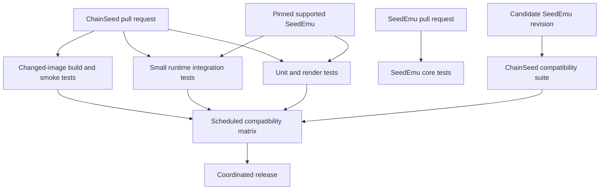

# ChainSeed Direct-cut Migration

[中文](migration.zh-CN.md) | English

## Source Mapping

| Current source | New owner |
|---|---|
| `seedemu/services/EthereumService` | `chainseed/ethereum` |
| `seedemu/services/MoneroService` | `chainseed/monero` |
| `seedemu/services/SolanaService` | `chainseed/solana` |
| `seedemu/services/ChainlinkService` | `chainseed/chainlink` |
| `seedemu/testing/blockchain.py` | `chainseed/testing` |
| `docker_images/seedemu-ethereum` | `images/ethereum` |
| `docker_images/seedemu-ethexplorer` | `images/ethexplorer` |
| `docker_images/seedemu-monero` | `images/monero` |
| `docker_images/seedemu-solana` | `images/solana` |
| `docker_images/seedemu-chainlink` | `images/chainlink` |
| `tools/Blockchain` | `tools` |
| `examples/blockchain` | `examples` and `experiments` |
| `tests/ethereum`, `tests/monero`, `tests/solana`, `tests/chainlink` | `tests` |
| Blockchain developer documentation | `docs` |
| Blockchain-only Python dependencies | ChainSeed dependency groups |

All blockchain tests move to ChainSeed. SeedEmu retains no ChainSeed fixture,
import, checkout step, or blockchain-specific compatibility job.

## Work Packages

### 1. Freeze the Boundary

1. Record the source commit used for extraction.
2. Inventory Python imports, image names, labels, generated artifacts, tests,
   documentation, and external datasets.
3. Define extension API version 1 and the ChainSeed label schema.
4. Stop adding blockchain features to `seed-emulator`.

### 2. Prepare SeedEmu

1. Publish the extension API used by `Layer`, `Service`, `Server`, and `Node`.
2. Introduce compiler-neutral `SystemProfile` objects through the existing node base-system API.
3. Add extension descriptors and the versioned dump envelope.
4. Keep generic runtime probes in `seedemu.testing`.
5. Expose candidate revisions and stable extension API metadata for external
   consumer testing.

### 3. Build ChainSeed

1. Move service code while preserving Git history.
2. Replace wildcard and internal compiler imports with public API imports.
3. Separate chain-independent helpers from chain-specific packages.
4. Move image recipes, tools, tests, examples, and documentation.
5. Convert D61 source, scripts, and runbooks into versioned experiments.
6. Replace large generated data with external manifests.

### 4. Coordinate the Direct Cut

1. Prepare paired SeedEmu and ChainSeed working trees with the required public
   API and all blockchain examples importing `chainseed`.
2. Run local tests and both repositories' remote CI/CD.
3. Set both projects' release metadata to `1.0.0`.
4. Build pinned ChainSeed images and run the joint compatibility matrix.
5. Tag and publish SeedEmu `v1.0.0` from its current fork remote; never push or
   tag the SeedEmu upstream remote during this validation.
6. Tag and publish ChainSeed `v1.0.0` from its current remote.
7. Reinstall both projects from those tags and rerun installation/runtime tests.
8. Only after that validation, open the SeedEmu pull request against upstream.

No aliases, forwarding modules, wrapper scripts, or deprecated import paths are
introduced.

## Dependency Cleanup

`seedemu/services/__init__.py` and `seedemu/__init__.py` stop exporting
blockchain classes. ChainSeed uses explicit imports from `seedemu.core` and
other documented packages.

Blockchain-only dependencies, including Ethereum account and RPC libraries,
move from the SeedEmu development environment to scoped ChainSeed extras:

```text
chain-seed[ethereum]
chain-seed[monero]
chain-seed[solana]
chain-seed[chainlink]
chain-seed[observability]
chain-seed[dev]
```

The base ChainSeed install supports topology rendering. Client-specific
host-side libraries are installed only by the relevant extra.

## CI Design



### ChainSeed Pull Requests

- Run unit and render tests for all chain packages.
- Test against a pinned supported SeedEmu revision.
- Build only changed image targets.
- Run one small runtime smoke test per affected chain.
- Validate examples, image manifests, schemas, and documentation.

### SeedEmu Changes

- SeedEmu CI runs only SeedEmu unit and integration tests.
- An external trigger supplies the candidate SeedEmu revision to ChainSeed.
- ChainSeed CI runs its import, render, compile, and runtime suite against that
  candidate.
- Compatibility failures are owned and diagnosed in ChainSeed, not by a
  ChainSeed fixture in SeedEmu.

### Scheduled Tests

- Test released ChainSeed against released SeedEmu.
- Test ChainSeed default branch against SeedEmu default branch.
- Run broader multi-chain runtime tests.
- Keep large-scale 10-hour benchmarks manual or scheduled on dedicated hosts.

## Release Contract

Each ChainSeed release publishes:

- a Python package;
- signed source archives;
- an OCI image manifest with digests;
- supported SeedEmu and chain-client versions;
- experiment schema versions;
- migration notes for ChainSeed API changes.

Both release commits are frozen and tested before publication. For the initial
validation, SeedEmu is published from its current fork remote first because
ChainSeed declares it as a dependency; ChainSeed is published immediately
afterward. Both tags are reinstalled and tested before any upstream SeedEmu PR
is opened. The upstream remote is never modified directly. A failed cut is
corrected with new release tags, not by maintaining two live implementations.

## Acceptance Criteria

### Repository Boundary

- `seed-emulator` contains no blockchain service implementation or client
  image recipe.
- `chain-seed` has a one-way package dependency on SeedEmu.
- Import-graph checks find no reverse or circular dependency.

### Functional

- Canonical Ethereum PoW/PoS, Monero, Solana, and Chainlink examples render.
- Small runtime tests produce blocks and submit transactions.
- Explorer and wallet tools discover nodes through the ChainSeed label schema.
- Large-scale experiment generation remains reproducible from manifests.

### Build and Release

- Released examples resolve images by digest.
- Changed-image CI does not rebuild unrelated clients.
- ChainSeed compatibility CI detects a breaking SeedEmu candidate.
- Package, image, schema, and client versions are recorded together.

### Data

- No generated deployment, client database, packet capture, or large raw sample
  is committed.
- Every external dataset has a URI, checksum, schema, and generator commit.

## Known Breaking Changes

- Old `seedemu.services.*` blockchain imports fail immediately.
- Old pickled emulators containing blockchain classes do not load.
- Existing scripts must install `chain-seed` and update imports.
- Image names and labels may change once, atomically, to the versioned ChainSeed
  conventions.
- Tools that parse old labels must move and update in the same release.
