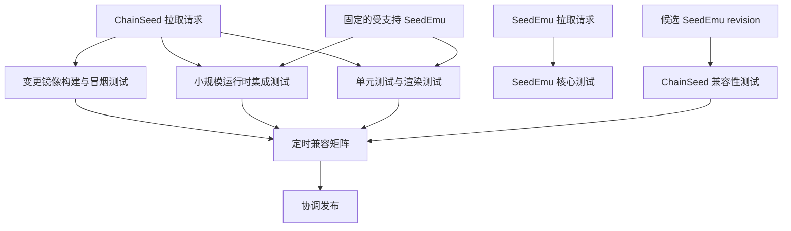

# ChainSeed 直接切换迁移

中文 | [English](migration.md)

## 源码映射

| 当前源码 | 新归属 |
|---|---|
| `seedemu/services/EthereumService` | `chainseed/ethereum` |
| `seedemu/services/MoneroService` | `chainseed/monero` |
| `seedemu/services/SolanaService` | `chainseed/solana` |
| `seedemu/services/ChainlinkService` | `chainseed/chainlink` |
| `seedemu/testing/blockchain.py` | `chainseed/testing` |
| `docker_images/seedemu-ethereum` | `images/ethereum` |
| `docker_images/seedemu-ethexplorer` | `images/ethexplorer` |
| `docker_images/seedemu-monero` | `images/monero` |
| `docker_images/seedemu-solana` | `images/solana` |
| `docker_images/seedemu-chainlink` | `images/chainlink` |
| `tools/Blockchain` | `tools` |
| `examples/blockchain` | `examples` 和 `experiments` |
| `tests/ethereum`、`tests/monero`、`tests/solana`、`tests/chainlink` | `tests` |
| 区块链开发文档 | `docs` |
| 区块链专用 Python 依赖 | ChainSeed 依赖组 |

所有区块链测试都迁移到 ChainSeed。SeedEmu 不保留 ChainSeed 测试夹具、
导入、检出步骤或区块链专用兼容性任务。

## 工作包

### 1. 冻结边界

1. 记录用于拆分的源码提交。
2. 清点 Python 导入、镜像名、标签、生成制品、测试、文档和外部数据集。
3. 定义扩展 API 版本 1 和 ChainSeed 标签模式。
4. 停止向 `seed-emulator` 添加新的区块链功能。

### 2. 准备 SeedEmu

1. 发布 `Layer`、`Service`、`Server` 和 `Node` 使用的扩展 API。
2. 在节点模型中加入与编译器无关的基础镜像引用。
3. 加入扩展描述符和带版本的 dump 封装。
4. 仅在 `seedemu.testing` 中保留通用运行时探针。
5. 对外提供候选 revision 和稳定扩展 API 元数据，供使用方测试。

### 3. 构建 ChainSeed

1. 在保留 Git 历史的前提下迁移服务代码。
2. 将通配符和编译器内部导入替换为公共 API 导入。
3. 分离与链无关的帮助代码和各链专用包。
4. 迁移镜像配方、工具、测试、示例和文档。
5. 将 D61 的源码、脚本和 runbook 转换为带版本的实验。
6. 将大型生成数据替换为外部数据清单。

### 4. 协调直接切换

1. 准备配套的 SeedEmu 与 ChainSeed 工作树，加入所需公共 API，并让所有
   区块链示例导入 `chainseed`；
2. 运行本地测试以及两个仓库的远端 CI/CD；
3. 将两个项目的发布元数据设置为 `1.0.0`；
4. 构建固定版本的 ChainSeed 镜像并运行联合兼容矩阵；
5. 从 SeedEmu 当前 fork 远端发布 `v1.0.0`，验证期间绝不推送或标记 upstream；
6. 从 ChainSeed 当前远端发布 `v1.0.0`；
7. 从两个 tag 重新安装并运行安装与运行时测试；
8. 验证通过后再向 SeedEmu upstream 提交 PR。

不会引入别名、转发模块、包装脚本或已弃用导入路径。

## 依赖清理

`seedemu/services/__init__.py` 和 `seedemu/__init__.py` 停止导出区块链类。
ChainSeed 仅从 `seedemu.core` 等有文档约束的包中显式导入。

Ethereum 账户与 RPC 库等区块链专用依赖，从 SeedEmu 开发环境移至
ChainSeed 的功能依赖组：

```text
chain-seed[ethereum]
chain-seed[monero]
chain-seed[solana]
chain-seed[chainlink]
chain-seed[observability]
chain-seed[dev]
```

基础 ChainSeed 安装支持拓扑渲染。特定客户端所需的宿主机库，只由对应
功能依赖组安装。

## CI 设计



### ChainSeed 拉取请求

- 运行所有链软件包的单元测试和渲染测试。
- 使用固定的受支持 SeedEmu revision 运行测试。
- 只构建发生变更的镜像目标。
- 每种受影响的链运行一个小型运行时冒烟测试。
- 验证示例、镜像清单、模式和文档。

### SeedEmu 修改

- SeedEmu CI 只运行 SeedEmu 自身的单元测试和集成测试。
- 外部触发器把候选 SeedEmu revision 传给 ChainSeed。
- ChainSeed CI 针对该候选版本运行导入、渲染、编译和运行时测试。
- 兼容性失败由 ChainSeed 定位，不在 SeedEmu 中保留 ChainSeed 测试夹具。

### 定时测试

- 测试已发布 ChainSeed 与已发布 SeedEmu 的组合。
- 测试 ChainSeed 默认分支与 SeedEmu 默认分支的组合。
- 运行覆盖更多币种的运行时测试。
- 10 小时大规模基准继续由专用主机手动或定时运行。

## 发布契约

每个 ChainSeed 版本发布：

- Python 软件包；
- 签名源码归档；
- 包含 digest 的 OCI 镜像清单；
- 支持的 SeedEmu 和链客户端版本；
- 实验模式版本；
- ChainSeed API 变更迁移说明。

两个发布提交必须在发布前冻结并完成联合测试。首次验证时，由于 ChainSeed
声明 SeedEmu 为依赖，应先从 SeedEmu 当前 fork 远端发布，随后从 ChainSeed
当前远端发布。必须从两个 tag 重新安装并测试通过后，才能提交 SeedEmu
upstream PR；不得直接修改 upstream。发布失败时使用新版本标签修复，不维护
两套并行实现。

## 验收条件

### 仓库边界

- `seed-emulator` 不包含区块链服务实现或客户端镜像配方。
- `chain-seed` 只保持到 SeedEmu 的单向软件包依赖。
- 导入图检查不存在反向或循环依赖。

### 功能

- Ethereum PoW/PoS、Monero、Solana 和 Chainlink 规范示例可以渲染。
- 小型运行时测试可以产生区块并提交交易。
- Explorer 和钱包工具可以通过 ChainSeed 标签模式发现节点。
- 大规模实验可以根据清单重现生成过程。

### 构建与发布

- 发布示例通过 digest 解析镜像。
- 镜像 CI 不重建未受影响的客户端。
- ChainSeed 兼容性 CI 能发现破坏兼容性的 SeedEmu 候选版本。
- 软件包、镜像、模式和客户端版本被统一记录。

### 数据

- 不提交生成部署、客户端数据库、抓包或大型原始采样。
- 每个外部数据集都有 URI、校验和、模式及生成器提交。

## 已知破坏性变更

- 旧 `seedemu.services.*` 区块链导入立即失效。
- 包含区块链类的旧 pickle 仿真器文件无法加载。
- 现有脚本必须安装 `chain-seed` 并更新导入。
- 镜像名和标签可在直接切换中一次性迁移到带版本的 ChainSeed 规范。
- 解析旧标签的工具必须在同一发布中完成迁移和更新。
