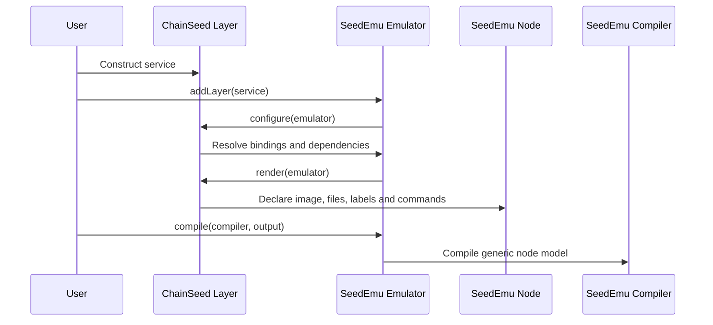
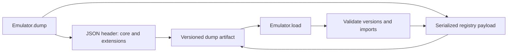
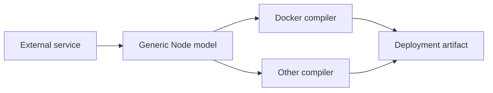

# SeedEmu Integration Contract

[中文](seedemu-integration.zh-CN.md) | English

## Implementation status

Currently implemented in the coordinated working trees:

- explicit ChainSeed imports and ordinary `Emulator.addLayer()` integration;
- the generic `ImageRef`/`Node.setBaseImage` compiler boundary.
- generic Docker Compose service registration and compiled-network name lookup,
  used by the ChainSeed-owned EthExplorer deployment adapter.

Planned, but not yet implemented by SeedEmu:

- SeedEmu-side entry-point discovery and `requireExtension()`;
- extension data in compile manifests;
- the versioned dump envelope and pre-deserialization validation.

The sections below describe the target contract. Features in the planned list
must not be documented or tested as already available until their code lands.

## SeedEmu After the Cut

```text
seedemu/
├── core/
│   ├── Emulator
│   ├── Layer
│   ├── Service
│   ├── Server
│   ├── Node
│   ├── Registry
│   └── extension
├── layers/
├── compiler/
├── hooks/
├── mergers/
├── services/
│   └── protocol-independent services
└── testing/
    ├── base
    └── runtime
```

The package contains no blockchain client, chain configuration, blockchain
test probe, explorer, or blockchain-specific dependency.

## Integration Model

ChainSeed classes remain ordinary external subclasses of SeedEmu `Layer`,
`Service`, and `Server`. Users construct them explicitly and add them to an
`Emulator`; SeedEmu does not dynamically import or instantiate ChainSeed.



Python entry-point discovery reports installed extensions and validates
artifacts. It does not replace explicit imports.

## Public API Version 1

### Emulator and Registry

| Operation | Purpose |
|---|---|
| `addLayer(layer)` | Register an external layer |
| `getLayer(name)` | Resolve a declared layer dependency |
| `getBindingFor(vnode)` | Resolve a virtual blockchain role to a physical node |
| `getServerByVirtualNodeName(vnode)` | Resolve another service's virtual server |
| `getRegistry()` | Inspect rendered nodes through stable registry queries |
| `requireExtension(descriptor)` | Record artifact provenance and requirements |

External services must not depend on Registry key layout or private Emulator
fields.

### Layer and Service

| Operation | Purpose |
|---|---|
| `addDependency(name, optional, configure)` | Declare render ordering |
| `install(vnode)` | Create a virtual server |
| `configure(emulator)` | Resolve cross-layer inputs |
| `render(emulator)` | Attach the service to bound nodes |
| `getTargets()` | Read rendered server/node pairs |

Layer names are stable identifiers because dependency ordering and existing
cross-service lookup use them. ChainSeed owns its names, including
`EthereumService`, `MoneroService`, `SolanaService`, and `ChainlinkService`.

### Node Specification

| Operation | Purpose |
|---|---|
| `addSoftware(packages)` | Declare host packages |
| `addBuildCommand(command)` | Declare image build steps |
| `setFile(path, content)` | Add generated configuration |
| `importFile(host, guest)` | Add a repository/runtime artifact |
| `appendStartCommand(command, fork)` | Add process startup |
| `setLabel(key, value)` | Expose role and discovery metadata |
| `addPersistentStorage(path)` | Declare persistent state |
| `addSharedFolder(host, guest)` | Mount an experiment artifact |
| `addPortForwarding(host, container)` | Expose RPC or UI |
| `setBaseImage(image_ref)` | Declare an external image reference |

`setBaseImage` stores a compiler-neutral `ImageRef` on the node:

```text
repository, tag, digest, platform
```

Only `repository` and either `tag` or `digest` are required. Release manifests
use digests. Docker-specific objects and image-priority lists remain private to
the Docker compiler.

### Runtime Testing

SeedEmu retains generic operations:

- discover containers and inspect generic labels;
- map container PIDs and enter namespaces;
- execute a command or HTTP probe;
- read resource counters and packet captures.

ChainSeed owns protocol interpretation, chain-health probes, transaction
generation, block/finality checks, and blockchain result schemas.

## Extension Descriptor

SeedEmu defines a small immutable descriptor:

```text
distribution
version
extension_api_version
owned_layer_names
artifact_schema_versions
```

When ChainSeed registers its first layer, the descriptor is attached to the
Emulator. Compilation emits it into `seedemu-manifest.json`; dump serialization
includes the same requirement.

Duplicate ownership of a layer name is an error. An unsupported extension API
version fails before configure or load.

## Dump Format

Raw Registry pickle files are replaced by an envelope with a readable header
and a checksummed payload:



Validation occurs before deserialization so a missing ChainSeed installation
produces an actionable error. The format is generic and may support other
external service repositories.

## Compiler Boundary

The compiler consumes only the rendered generic node model. It must not import
ChainSeed or contain chain-specific image selection.



The compiler-specific Monero image override is replaced by
`Node.setBaseImage`. EthExplorer uses the public Docker
`addComposeService()` and `getComposeNetworkName()` operations to contribute
auxiliary containers without accessing compiler state. These operations are
generic Docker deployment primitives: SeedEmu neither imports ChainSeed nor
contains knowledge of Explorer services. The legacy SeedEmu Explorer
implementation remains temporarily available only during migration validation.

## Package and Import Rules

ChainSeed is expected to depend on and import SeedEmu. The boundary concerns
dependency direction and public API stability, not the existence of imports.

Allowed:

```python
from seedemu import Binding, Emulator, Filter
from seedemu.core import Emulator, Node, Service, Server
from seedemu.compiler import Docker, Platform
```

Explicit imports are preferred in library code because they make compatibility
changes visible. Educational examples may continue to use `from seedemu import
*`; wildcard imports are a maintainability concern rather than an architecture
violation.

Not allowed in ChainSeed service implementations:

```python
from seedemu.compiler.DockerImage import DockerImage
from seedemu.services.EthereumService import EthereumService
```

SeedEmu public modules may not import `chainseed`, inspect a ChainSeed package
path, or special-case a blockchain layer name.

## ChainSeed-owned Compatibility Test

The currently implemented compatibility gate requires the ChainSeed-owned suite
to:

1. import all public extension interfaces;
2. render a minimal Ethereum PoS topology;
3. compile it with the Docker compiler;
4. verify ChainSeed image requirements in public compiler output.

When the planned extension metadata and dump work lands, the suite will also:

- verify extension data in compile manifests;
- load a versioned dump when ChainSeed is installed;
- reject that dump with a clear error when ChainSeed is absent.

The test code and execution workflow live only in ChainSeed. SeedEmu CI does
not install, import, or check out ChainSeed. A candidate SeedEmu revision is
passed to the ChainSeed workflow by an external trigger or a release gate.
